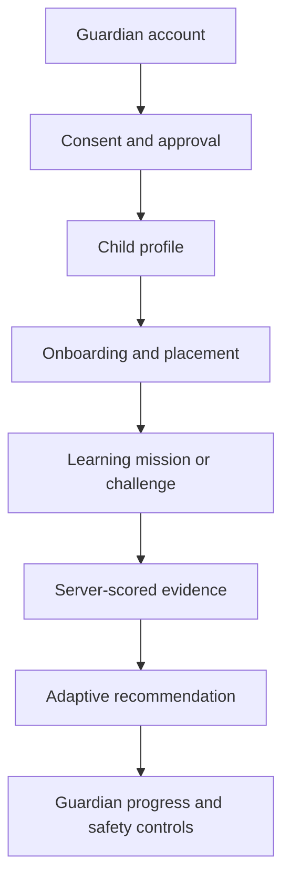

# Product Requirements, Personas, and Traceability

**Purpose:** connect requirements to actual pages, APIs, data, engines, and tests.  
**Applies to:** learner, guardian, moderator, and administrator journeys.  
**Status:** `MIXED — implemented features and explicit release gates`.

## Product thesis

USAM Kids turns short bilingual learning experiences into evidence-backed progress for ages 7–15. The learner receives an age-aware pathway, diagnostic placement, guided practice, creative/coding work, and safe companion help. The guardian retains control over child profiles, time, guides, voice playback, export, and deletion.

## Core requirements matrix

| REQ | Feature | Page/API/Data/Role | Engine/Test | Priority | Status |
|---|---|---|---|---|---|
| REQ-001 | Guardian-first child creation | `/signup`, `/guardian`; `/api/auth/*`, `/api/guardians/learners`; users/learners | Auth + consent; API authorization tests | P0 | Implemented |
| REQ-002 | Child-safe learning | `/app`, worlds, missions, age challenges; attempts/activities | Mission, evidence, mastery; content/engine tests | P0 | Implemented |
| REQ-003 | Exact age paths | `/app/challenges`; activities | age challenge content | 9×100 challenge test | P0 | Implemented |
| REQ-004 | Adaptive next step | home/practice; `/api/adaptive/*` | adaptive learning signals | platform engine tests | P0 | Implemented |
| REQ-005 | Guardian safety controls | guardian child safety; controls/time-limit APIs | time and consent policy | API end-to-end test | P0 | Implemented |
| REQ-006 | Private evidence/projects | progress/projects/portfolio; projects/evidence APIs | project/evidence engine | API ownership tests | P0 | Implemented |
| REQ-007 | Safe companions | characters/conversations; `/api/assist` | rules guidance + evaluations | 75 evaluation checks | P0 | Implemented, no live model |
| REQ-008 | Operations/moderation | moderator/admin routes and APIs | moderation/audit/analytics | API tests | P1 | Implemented foundation |
| REQ-009 | Live child service | email, EC2, TLS, consent language, monitoring | deployment/incident process | manual release evidence | P0 release gate | Blocked externally |

## Personas and acceptance criteria

| Persona | First value | Repeat value | Observable acceptance |
|---|---|---|---|
| Learner | Finishes placement and first mission | Receives a review/recommendation | Cannot view another child’s evidence; score is server-calculated |
| Guardian | Creates exact-age profile after required gates | Reviews evidence and controls time | Can export/delete only linked child data; time limit pauses learner mutations |
| Moderator | Sees a report case | Records human resolution | Learner cannot access moderator routes; decision is audited |
| Admin | Reviews operational state/content drafts | Manages safe flags and audit view | Admin-only server authorization is tested |

## Opportunity backlog

| ID | Opportunity | Value | Effort | Decision / trigger |
|---|---|---|---|---|
| OPP-001 | EC2 observability service with alert delivery | Detect real outages | M | P0 release gate; owner selects provider and alert recipient |
| OPP-002 | Reviewed live AI provider adapter | Better conversational support | L | P1 only after child-safety evaluation and consent policy |
| OPP-003 | Speech assessment | English practice feedback | L | P2 only with recording consent, provider review, and deletion workflow |
| OPP-004 | Public moderated showcase | Celebrate projects | M | P2 after moderation policy and guardian publication consent |

