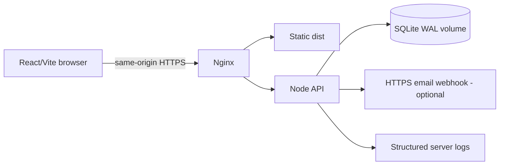

# Architecture, Data, Engines, and Roles

**Purpose:** document the buildable modular-monolith architecture.  
**Sources:** `src/`, `server/`, Docker deployment files.  
**Status:** `CURRENT IMPLEMENTATION`.

## Bounded modules

| Module | Main files | Responsibilities | Data |
|---|---|---|---|
| Presentation | `src/main.jsx`, feature JSX modules | routes, RTL/LTR, accessible controls, local demo fallback | local state only for demo |
| Auth/identity | `server/app.mjs` | sessions, guardian registration, password reset/verification | users, sessions, resets, verifications |
| Learning | `src/engine.js`, `server/app.mjs` | placement, missions, attempts, activities, evidence, mastery | placements, attempts, activities |
| Adaptation | `src/platform-engines.js` | ZPD, cognitive load, interleaving, next action | derived from evidence |
| Guardian | `operations.jsx`, API routes | linked-child access, consent, controls, time limits | consents, limits, usage, goals |
| Projects | `workshop.jsx`, project APIs | private artifacts, notes, milestones, moderated request | projects, notes, milestones |
| Safety/admin | moderation/admin modules | reports, audits, flags, curriculum drafts | reports, audit, flags |

## Role × resource policy

| Role | Read | Create/update | Restricted |
|---|---|---|---|
| Visitor | public pages | none | API private data, child accounts |
| Learner session | own progress, own private projects/conversations | own learning artifacts | other learners, guardian/admin data |
| Guardian | linked children only | profiles, controls, goals, limits, export/delete | unlinked child data, staff controls |
| Moderator | assigned reporting views | report resolution | learner content absent a report policy |
| Admin | operational aggregates/drafts/flags | guarded admin actions | raw secrets and unscoped child data |

## Engine capability matrix

| ENG | Current decision | Evidence | Failure behavior |
|---|---|---|---|
| ENG-001 Authentication | Required now | secure cookie session, role/ownership guard | 401/403 error envelope |
| ENG-002 Learning/Mastery | Required now | deterministic server scoring and spaced review | invalid evidence rejected |
| ENG-003 Adaptive | Required now | `learningSignals()` APIs | baseline recommendation if limited evidence |
| ENG-004 Gamification | Required now | XP/level/streak/private rewards | no public ranks or paid shop |
| ENG-005 Companion | Required now, rules-based | safe guidance and controls | privacy prompt/restricted response |
| ENG-006 Voice | Provider-gated | browser playback only | disabled by guardian/platform flag |
| ENG-007 Payments | Not suitable now | no checkout/product decision | no billing UI or payment data |

