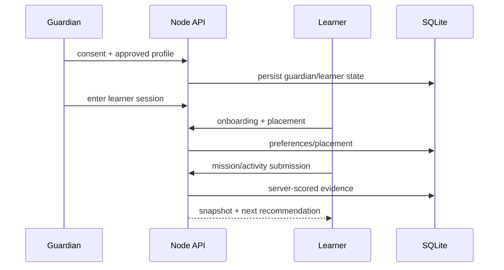

# Routes, APIs, and User Journeys

**Purpose:** route and contract ownership for the current product.  
**Status:** `CURRENT API AND ROUTE MAP`; detailed route evidence remains in `../route-code-matrix.csv`.

## Navigation contract

| Surface | Entry | Controlled destination | Failure state |
|---|---|---|---|
| Public | header/footer | public journey/info/auth routes | `/unauthorized`, `/session-expired`, fallback page |
| Learner | onboarding or guardian-entered child session | `/app`, worlds, missions, practice, projects | auth guard sends sign-in screen; time limit pauses mutations |
| Guardian | `/guardian` | linked child detail tabs, goals, recommendations, account | 401/403 API envelope and UI error |
| Staff | `/admin`, `/moderator` | role-specific operations | server role check, not hidden-button logic |

## Contract families

| API family | Purpose | Authorization | Key failures |
|---|---|---|---|
| `/api/auth/*` | guardian lifecycle/session/recovery | public or guardian as applicable | invalid credentials, rate limited, delivery unavailable |
| `/api/guardians/*`, `/api/guardian/*`, `/api/parents/*` | linked child profile/control/insight | guardian ownership | learner not linked, consent/approval required |
| `/api/placement`, `/api/attempts`, `/api/activities`, `/api/learning-sessions/*` | scored evidence | learner session, time guard | invalid answer, already complete, paused time |
| `/api/adaptive/*`, `/api/daily-goals/*`, `/api/gamification/*` | derived learning signal | learner session | unknown capability, not enough coins |
| `/api/projects/*` | private projects, milestones, safe showcase request | project owner/linked guardian where documented | private info, project not found, collaboration disabled |
| `/api/assist`, `/api/conversations/*`, `/api/reports` | safe companion and escalation | learner session | guide disabled, private information, rate limited |
| `/api/admin/*`, `/api/moderation/*` | staff operation | admin/moderator | forbidden |

## Critical learner sequence

## Contract acceptance

- Persistent child actions require a learner-scoped session and server-side ownership check.
- A creative branch is completion evidence, not fabricated mastery.
- Guardian actions enforce child linkage at the API.
- All JSON responses include a request identifier and baseline security headers.
- Contract tests cover positive and negative authorization paths.

